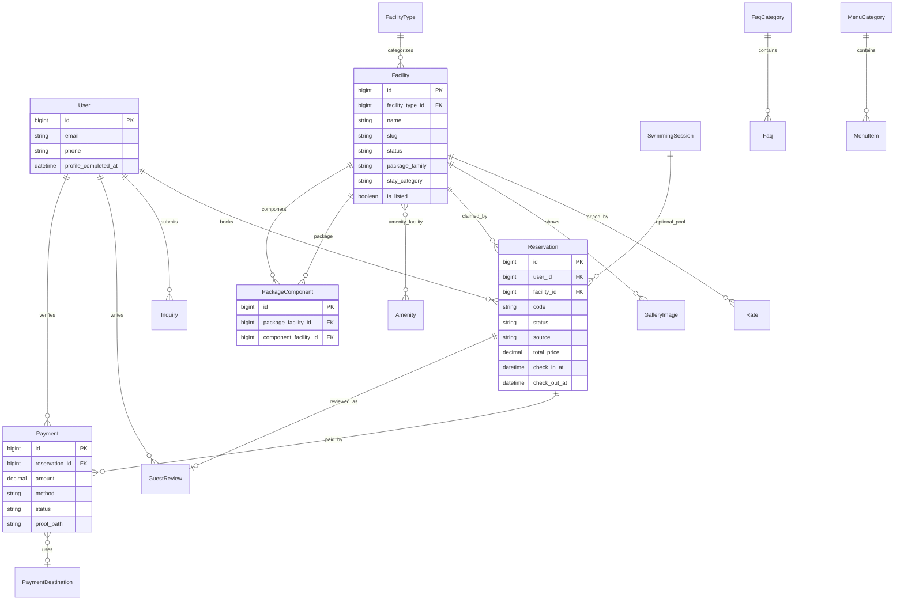

# Database Schema — SCHEMA.md

**Engine:** MySQL 8 via Laravel Eloquent  
**Note on RLS:** This project does **not** use PostgreSQL Row Level Security. Access control is application-layer (see [RLS Policies](#rls-policies-application-layer-authorization)).

---

## Tables

### Platform / Laravel

| Table | Purpose |
|-------|---------|
| `users` | Guests and administrators; `phone`, `profile_completed_at` |
| `password_reset_tokens` | Password reset |
| `sessions` | Session driver table (available; local default is file) |
| `cache`, `cache_locks` | Cache driver tables |
| `jobs`, `job_batches`, `failed_jobs` | Database queue |
| `notifications` | In-app notifications |
| `permissions`, `roles`, `model_has_*`, `role_has_permissions` | Spatie Permission |
| `activity_log` | Spatie Activitylog (custom immutable model) |

### Core booking

| Table | Purpose |
|-------|---------|
| `facility_types` | Catalog types (room, cottage, function_hall, resort_package, …) |
| `facilities` | Shared inventory units + packages; soft deletes; package/stay catalog columns |
| `amenities` | Amenity definitions |
| `amenity_facility` | Facility ↔ amenity pivot |
| `rates` | Base / seasonal / extra person / additional charge rates per facility |
| `gallery_images` | Per-facility gallery |
| `package_components` | Package facility → component facility edges |
| `reservations` | Bookings; guest sheet; pricing snapshot; deposit / lifecycle; soft deletes |
| `payments` | Payment ledger + proof; destination snapshot; soft deletes |
| `payment_destinations` | Staff-managed GCash/Maya/bank destinations + QR |
| `swimming_sessions` | Pool session catalog (fees, windows) |
| `email_otp_verifications` | Pre-registration OTP hashes and attempt counters |

### Content & resort services

| Table | Purpose |
|-------|---------|
| `page_photos` | Public gallery CMS (`collection`) |
| `faq_categories`, `faqs` | FAQ |
| `inquiries` | Guest inquiries + admin response |
| `guest_reviews` | Post-stay reviews + moderation |
| `resort_pools` | Pool marketing / catalog |
| `resort_rules` | Rules (`is_public` for guest-facing) |
| `resort_fees` | Fee catalog |
| `resort_settings` | Key/value settings (`key` PK) |
| `menu_categories`, `menu_items` | On-site menu catalog |

### Removed

Training batch / application tables were dropped (`2026_09_07_000000_drop_training_tables`). Create migrations for training are no longer in the tree.

---

## ERD (Entity Relationship Diagram)

### Relationship narrative

- **Booking spine:** `User` books a `Facility` (typed room / cottage / hall / package). Optional `SwimmingSession` for pool day-use. One or more `Payment` rows settle the reservation. After stay, optional `GuestReview`.
- **Package graph:** A `Facility` with type resort package owns `PackageComponent` rows pointing at constituent facilities. Availability and Decision Board use the same coupling.
- **Rates:** Multiple `Rate` rows per facility; live pricing selects applicable rows; reservation stores a **snapshot**.
- **Audit:** Activity log morphs to subjects (e.g. reservations) and causers (users).

---

## RLS Policies (application-layer authorization)

There are **no Postgres RLS policies**. Equivalent controls:

### Roles

| Role | Access |
|------|--------|
| `Administrator` | `/admin/*` via `EnsureAdministrator` + `access-admin` gate |
| `Customer` | Guest portal under `auth` + ownership checks |

### Policy class

- `UserPolicy` — admin can viewAny/create/delete (not self); admin or self for view/update.

### Service ownership / staff gates

| Area | Rule |
|------|------|
| Customer reservations / payments / inquiries | Actor `user_id` must match resource owner |
| Walk-in create | Administrator only |
| Payment verify / reject / top-up / on-site record | Administrator |
| Admin facility / rate / page photo / customer management | `authorizeAdmin()` |
| Activity log | Immutable: model blocks update/delete (except console prune paths) |
| Public reviews | Published + visibility scopes; demo emails filtered when demo content off |

### Middleware / route posture

- Guests hitting `/admin*` → `/admin/login`; other guests → `/login`
- Throttle on search / OTP / sensitive public posts
- Signed routes for arrival pass where used

---

## Migrations

Migrations live in `database/migrations/`. Chronological themes:

| Phase | Migrations (representative) | Intent |
|-------|----------------------------|--------|
| Laravel base | `0001_01_01_000000` … `000002` | users, cache, jobs |
| Auth / audit | `2026_08_04_*` | Spatie permission + activity_log |
| Domain v1 | `2026_08_10_*` | facilities, rates, reservations, payments, FAQ, inquiries |
| Capacity / packages | `2026_08_12_*` | max_capacity, package_components |
| Stay ops | `2026_08_30`–`08_31` | extra hours, guest contact, check-in/out |
| CMS | `2026_09_02` page_photos; `09_06` dining cleanup + indexes |
| Remove training | `2026_09_07_000000_drop_training_tables` | Drop training product |
| Auth OTP / profile | `2026_09_08_*` | OTP table, profile_completed_at, cancel request |
| Guest sheet / indexes | `2026_09_09`–`09_10` | guest information sheet; activity + notification indexes |
| Resort services | `2026_09_10_150000` (+ `is_public` on rules) | pools, sessions, rules, fees, settings, menu |
| Reviews / catalog | `2026_09_11`–`09_12` | guest_reviews; rate unit normalize; package catalog columns |
| Deposits | `2026_09_13_100000_add_customer_deposit_workflow` | destinations, deposit fields, payment proof enhancements |

**Practice:** Prefer additive migrations; never edit applied migrations on shared environments. Data backfills (rate unit normalize, dining photo removal) should stay idempotent where possible.

---

## Models

Location: `app/Models/`.

| Model | Table | Notes |
|-------|-------|-------|
| `User` | `users` | Spatie `HasRoles`; reservations, inquiries, reviews |
| `Facility` | `facilities` | SoftDeletes; package family / stay category; contending facilities helpers |
| `FacilityType` | `facility_types` | Type catalog |
| `Rate` | `rates` | `RateType` / `RateUnit` |
| `Reservation` | `reservations` | SoftDeletes; status/source enums; pricing snapshot; guest sheet |
| `Payment` | `payments` | SoftDeletes; method/status enums |
| `PackageComponent` | `package_components` | Package graph edge |
| `Amenity` | `amenities` | M2M facilities |
| `GalleryImage` | `gallery_images` | Facility media |
| `PagePhoto` | `page_photos` | `PagePhotoCollection` |
| `FaqCategory` / `Faq` | FAQ tables | Public help |
| `Inquiry` | `inquiries` | Guest ↔ admin |
| `GuestReview` | `guest_reviews` | Moderation + public scopes |
| `ResortPool` | `resort_pools` | Pool catalog |
| `SwimmingSession` | `swimming_sessions` | Session fees / windows |
| `ResortRule` / `ResortFee` / `ResortSetting` | resort_* | Ops content / KV |
| `MenuCategory` / `MenuItem` | menu_* | Dining catalog |
| `PaymentDestination` | `payment_destinations` | Deposit targets |
| `EmailOtpVerification` | `email_otp_verifications` | Registration OTP |
| `ActivityLog` | `activity_log` | Extends Spatie; immutable |

### Important enums (`app/Enums/`)

`ReservationStatus`, `ReservationSource`, `PaymentMethod`, `PaymentStatus`, `GuestPaymentState`, `FacilityType`, `FacilityStatus`, `BookingServiceType`, `PackageFamily`, `StayCategory`, `RateType`, `RateUnit`, `GuestGender`, `InquiryStatus`, `PagePhotoCollection`, `ActivityActionType`, `Role`.

### Domain invariants stored in schema + app

- Reservation codes: `VM-YYYYMMDD-XXXXXX`
- Online → Pending; Walk-in → Approved
- Pending + Approved block availability
- Soft-deleted facilities still resolvable on historical reservations (`withTrashed` where needed)
- Payment proofs hashed / path-stored on private disk — not public URLs
